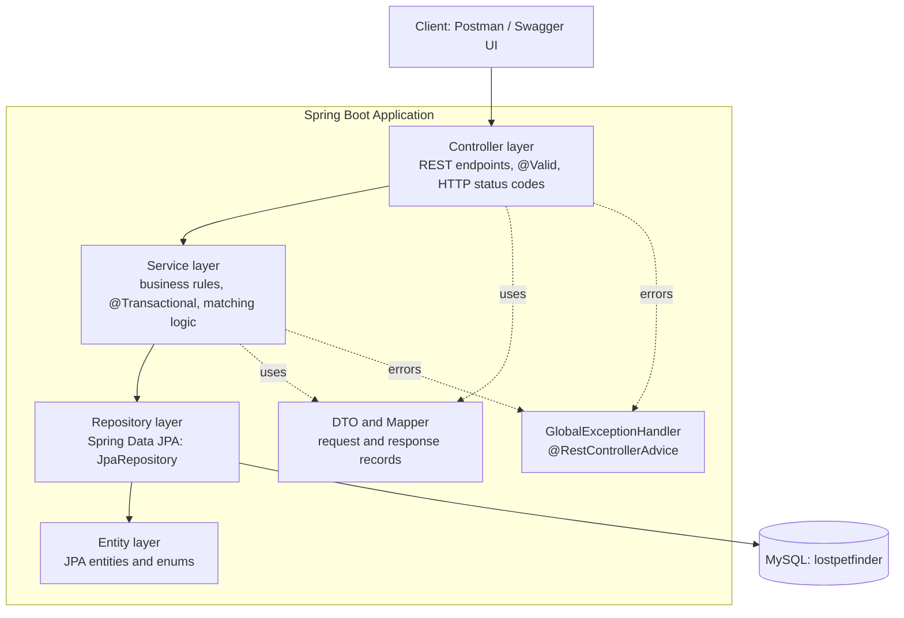
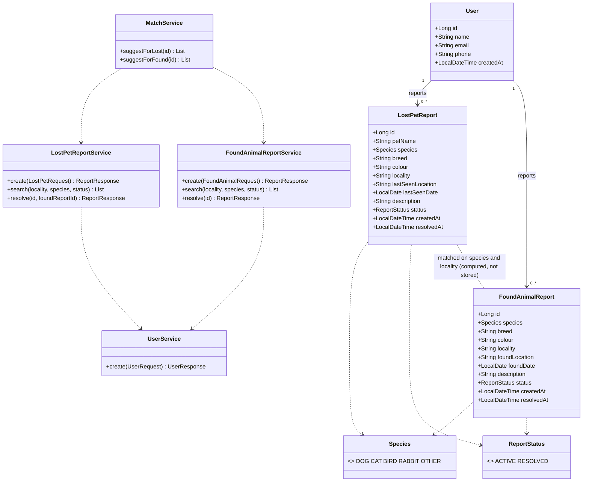
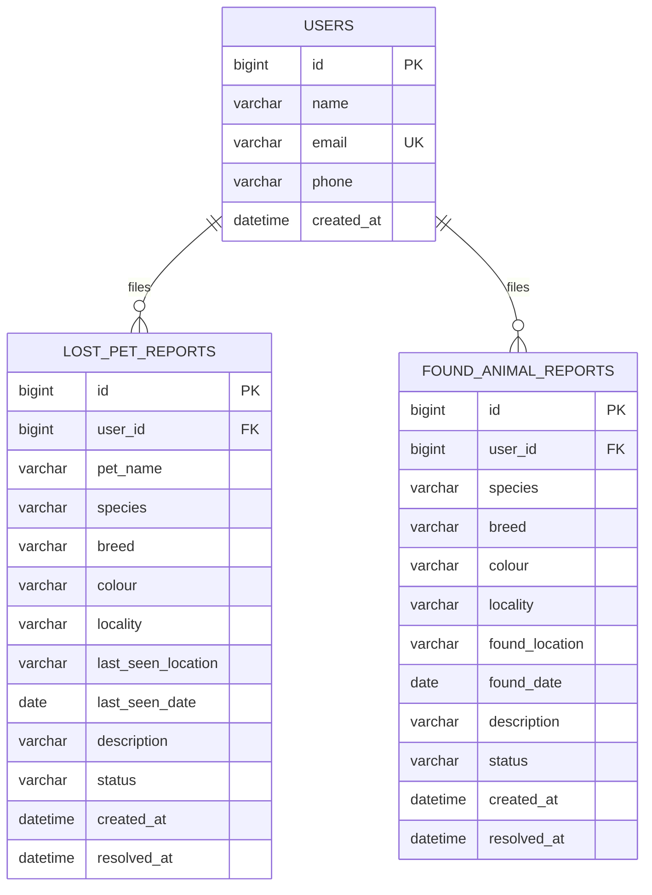
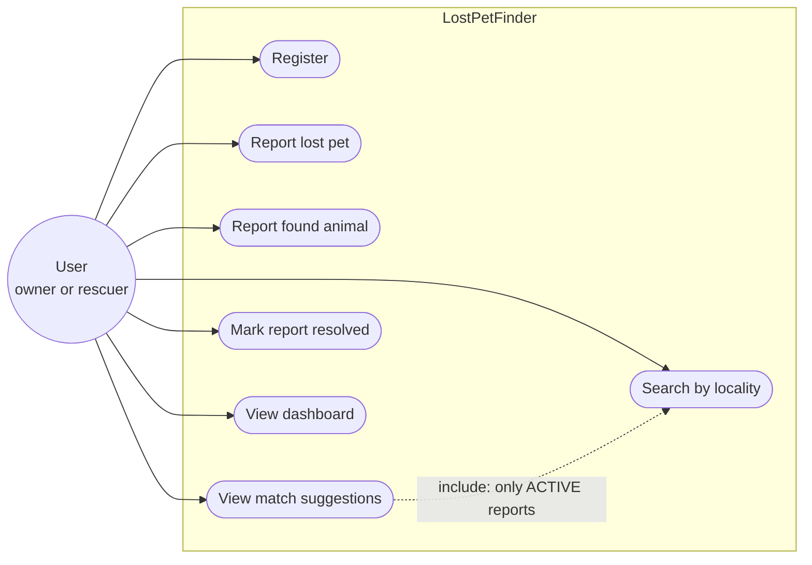
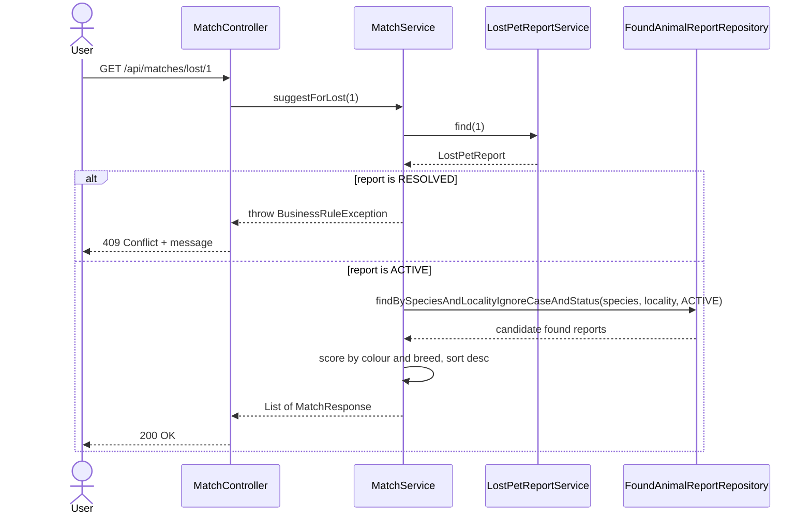
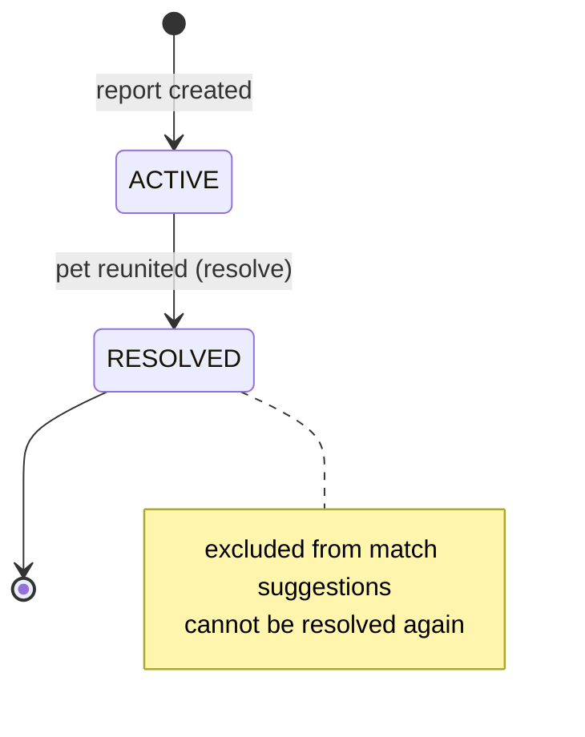

# LostPetFinder: Design Document

## 1. MVP (what to build, in priority order)

| # | Feature (from the question) | Endpoint | Must / Bonus |
|---|---|---|---|
| 0 | Register user (needed so reports have an owner) | `POST /api/users` | Must |
| 1 | Report a lost pet (species, breed, colour, last-seen location) | `POST /api/lost-reports` | Must |
| 2 | Report a found animal (same attributes) | `POST /api/found-reports` | Must |
| 3 | Suggest possible matches (species + locality minimum) | `GET /api/matches/lost/{id}`, `GET /api/matches/found/{id}` | Must |
| 4 | Mark a report resolved | `PUT /api/lost-reports/{id}/resolve`, `PUT /api/found-reports/{id}/resolve` | Must |
| 5 | Search reports by locality | `GET /api/lost-reports?locality=`, `GET /api/found-reports?locality=` | Must |
| 6 | Dashboard counts | `GET /api/dashboard` | Bonus ("Go Further") |
| 7 | Filter by species/status | query params on the list endpoints | Bonus |

### Business rules (enforced in the SERVICE layer)
1. A resolved report never appears in active match suggestions: candidates are fetched with `status = ACTIVE`, and asking for suggestions *for* a resolved report is rejected with **409** and a clear message.
2. Matching needs species AND locality (case-insensitive) at minimum. Colour (+2) and breed (+1) only rank results.
3. You cannot resolve a report twice (409).
4. Linking a lost and found report on resolve requires the same species, and the found report must still be active.
5. Referenced user must exist (404); email must be unique (409).

## 2. Layered architecture

Package layout: `controller`, `service`, `repository`, `entity`, `enums`, `dto`, `mapper`, `exception`.
Rule of thumb: controllers never touch repositories; entities are never returned to clients (DTOs only).

## 3. Class diagram

## 4. Database schema (ER diagram)

Design decisions worth saying in the viva:
- **Owner relationship**: `User` owns reports (`@ManyToOne` on the report, `@OneToMany(mappedBy)` on the user). The FK lives on the "many" side.
- **Matches are computed, not stored**: a match is a query on (species, locality, ACTIVE), so no join table and no stale data. A `Match` table would be a possible extension.
- **Composite index** `(species, locality, status)` on both report tables makes match queries fast.

## 5. UML use case diagram

## 6. Sequence diagram: suggest matches

## 7. Report lifecycle (state diagram)

## 8. HTTP status codes used

| Situation | Status |
|---|---|
| Created a user or report | 201 |
| Read, search, resolve, match | 200 |
| Validation failure, bad enum or date | 400 |
| User or report not found | 404 |
| Rule violated (resolved report, duplicate email, already resolved) | 409 |
| Unexpected error (no stack trace leaked) | 500 |

## 9. Step-by-step build order (as the question asks)
1. Spring Initializr: Web, Data JPA, Validation, MySQL Driver (+ Lombok, springdoc for Swagger).
2. Entities: `User`, `LostPetReport`, `FoundAnimalReport` + enums.
3. Repositories extending `JpaRepository`.
4. Services with the business rules.
5. Controllers, one endpoint per feature.
6. Validation annotations + `@RestControllerAdvice`.
7. Test in Swagger/Postman, including edge cases (`docs/api-tests.http`).
8. Bonus: dashboard and filters.
